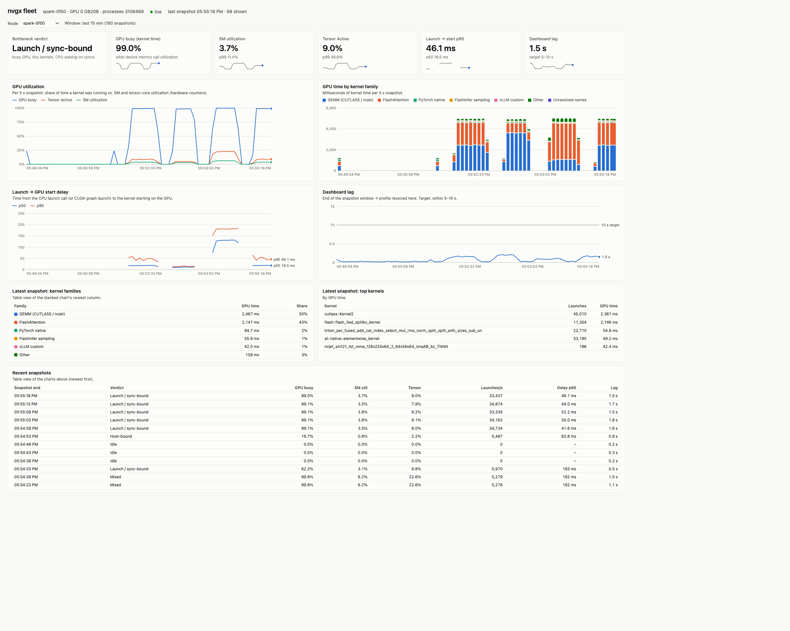

# POC: live fleet dashboard from the Nsight Perf SDK

Proof of concept for [design/fleet-profiling.md](../design/fleet-profiling.md): a GPU node streams a
**workload profile every 5 s** to a fleet service, which shows it on a live dashboard
**~5 s behind** (5 s window + well under 1 s of export and transfer).

```text
DGX Spark                                                        Mac (or any always-on box)
nvidia-nsight-perf (root)                                        nvgx_fleet.py  127.0.0.1:9100
   ▲ traced workloads                                              ├ POST /v1/profiles → SQLite
nvtrace_continuous_export (forked) --snapshot-ms 5000              ├ GET  /events (server-sent events)
   └ TeeSink ─┬─ DuckDbTableSink (local, unchanged)                └ GET  /  dashboard
              └─ FleetSink ── POST every snapshot ── SSH tunnel ──►
```

| Piece | Where | What it is |
|---|---|---|
| [`agent/NvgxFleetSink.h`](agent/NvgxFleetSink.h) | GPU node | `FleetSink`: a table sink with the same 7 methods as NVIDIA's DuckDB sink. Aggregates each snapshot's rows into a workload profile (kernel time by family, tiny-kernel share, CUDA-graph share, launch → GPU start delay, CPU sync wait, memcpy, GPU counters, verdict; with [NVTX step ranges](nvtx/README.md), GPU time by prefill / decode / mixed step) and POSTs it from a background thread with a bounded queue. `TeeSink` feeds DuckDB and FleetSink together. |
| [`agent/apply_fleet_patch.py`](agent/apply_fleet_patch.py) | GPU node | Applies 9 anchored edits to NVIDIA's `nvtrace_continuous_export.cpp` (SDK `beta-preview-update1`): include the header, add `--fleet-url` / `--fleet-node`, export through the TeeSink. |
| [`fleet/nvgx_fleet.py`](fleet/nvgx_fleet.py) | Mac | Fleet service, Python standard library only: receive profiles, store in SQLite (`~/.nvgx-fleet/fleet.db`), push to browsers over server-sent events, serve the dashboard. |
| [`fleet/static/`](fleet/static/) | Mac | Dashboard: stat tiles, GPU utilization, GPU time by kernel family, launch delay, lag, tables. Vanilla JS + SVG, light and dark mode. |

The POC posts straight to the fleet service. In production a message bus (Kafka, Pub/Sub, NATS) sits in
between; see the design doc.

## Run it

**On the GPU node (DGX Spark)**, after [Option A](../plan/option-a-cuda-compat.md) setup:

```shell
# 1. Build the forked exporter (~3 min, CUDA 13.0 toolkit is enough)
mkdir -p ~/nsight-perf-lab/fork && cd ~/nsight-perf-lab/fork
curl -fsSLO https://github.com/NVIDIA/nsight-perf-sdk-for-ai/releases/download/beta-preview-update1/nsight-perf-sdk-for-ai-beta-preview-update1-src.tar.gz
tar -xzf nsight-perf-sdk-for-ai-beta-preview-update1-src.tar.gz
python3 <repo>/poc/agent/apply_fleet_patch.py nsight-perf-sdk-for-ai-beta-preview
cmake -S nsight-perf-sdk-for-ai-beta-preview -B build -DCMAKE_CUDA_COMPILER=/usr/local/cuda/bin/nvcc
cmake --build build --target nvtrace_continuous_export -j

# 2. Root service (see scripts/start-root-service.sh), then the traced workload (scripts/run-vllm.sh)

# 3. Stream 5 s snapshots to the fleet (the tunnel below makes 127.0.0.1:9100 reach the Mac)
build/bin/nvtrace_continuous_export --snapshot-ms 5000 --stop-on-enter-key false \
  --output-dir ~/nsight-perf-lab/poc/live --fleet-url http://127.0.0.1:9100
```

**On the Mac:**

```shell
python3 poc/fleet/nvgx_fleet.py                        # fleet service + dashboard on 127.0.0.1:9100
ssh -N -R 9100:127.0.0.1:9100 <gpu-node>               # lets the node reach it
open http://127.0.0.1:9100                             # dashboard
```

## Live run (2026-11-22)



vLLM (Qwen3-0.6B) on the DGX Spark under a repeating load loop, streamed to the Mac dashboard:

| Load phase | GPU time by kernel family | Tensor Active | Launch → start p50 / p95 | Verdict |
|---|---|---|---|---|
| A: concurrency 16, 512 in / 256 out | GEMM 50%, FlashAttention 43% | ~9% | ~19 / ~45 ms | Launch / sync-bound |
| B: concurrency 4 | mostly GEMM | ~4% | ~10 / ~13 ms | Launch / sync-bound |
| C: concurrency 32, 2048 in / 64 out (prefill-heavy) | FlashAttention 74% | ~22% | ~120 / ~183 ms | Mixed |

In every phase GPU busy (kernel time) is ~99% while SM utilization stays at 3–6%.

**Variable workload.** That fixed three-phase `vllm bench serve` loop is now replaced by
[`workload/nvgx_load.py`](workload/README.md), a standard-library load generator that keeps changing
the traffic: multi-turn chat sessions whose number (0–64), prompt length (tens to ~3,000 tokens),
output length (16 to ~2,000 tokens) and arrival pattern (steady, bursts, idle gaps) move through
named regimes (trickle, chat, rag, decode, burst, steady-high). Prefill-heavy, decode-heavy, light,
saturated and idle periods all show up on the dashboard. It logs per-request TTFT, latency and time
per output token to JSONL, prints the current regime, and keeps going through server restarts.

**Cross-check:** phase A's split (GEMM 50%, FlashAttention 43%) matches the offline Perfetto SQL on the
earlier capture of the same benchmark (50.9% / 42.6%, [showcase](../showcases/2026-11-21-vllm-qwen3-0.6b/README.md)):
two independent paths, same answer.

**Timing:**

- Each 5 s snapshot is exported to DuckDB **and** FleetSink in 100–600 ms (budget: 5 s).
- Lag from the end of a snapshot window to the profile arriving on the Mac: **0.06–0.3 s idle, 0.9–1.8 s
  under load**. The newest dashboard data is at most ~7 s old, inside the 5–10 s target.
- Without the root service the profiles carry CUDA API and memcpy data but no kernel timings or counters
  (the same permission limit as in the [results](../results/2026-11-21-option-a-dgx-spark.md)).

## Prefill vs. decode (NVTX phases)

With the vLLM container started as `NVTX=1 scripts/run-vllm.sh` (see [nvtx/README.md](nvtx/README.md)),
every engine step is an NVTX range in domain `nvgx` whose message carries the step's prefill and decode
token counts. FleetSink reads two more SDK tables and adds three fields to each profile:

```json
"attribution": { "...": "...",
  "by_phase_ms": {"prefill": 0.0, "decode": 3890.5, "mixed": 1092.5, "unattributed": 0.0} },
"phase_tokens": {"prefill": 10585, "decode": 7108},
"phase_steps":  {"prefill": 0, "decode": 125, "mixed": 23}
```

- `attribution.by_phase_ms`: GPU kernel time (ms) in the window by step class: **prefill** (step has only
  prefill tokens), **decode** (only decode tokens), **mixed** (both: chunked prefill riding on a decode
  batch, the usual case under load), **unattributed** (not launched inside a step range, e.g. other
  processes or startup). Sums to `attribution.kernel_time_ms`.
- `phase_tokens`: prefill and decode tokens of the step ranges that ended in the window.
- `phase_steps`: number of those steps per class.

**Method: GPU kernel time per step class, not apportioned by tokens.**
`nvtx_gpu_projection_segments` has one row per GPU operation and NVTX range open when it was launched.
Immediate kernels map exactly through their kernel launch correlation ID. For CUDA graph kernels (nearly
all GPU time here), continuous export gives graph launches no GPU timestamps, so a node execution can't be
tied to one launch. The segments still give each node's graph executable and each launch's phase. So each
exec's kernel time in the window is split across phases in proportion to its launches per phase. vLLM
replays FULL graphs for decode-only batches and PIECEWISE graphs for batches with prefill, one exec per
padded batch size, so an exec's launches are the same shape and nearly always the same phase.
`phase_tokens` / `phase_steps` come from `nvtx_push_pop_ranges`. Retained history re-emits a range in up to
~3 snapshots, so a range only counts if it ends after the latest end already counted on its thread.

**Checked (2026-11-22):** over the same 25 s, the fleet profiles said decode 62.5% / mixed 37.5% /
unattributed 0%, and the exact per-kernel projection in the Perfetto export said 61.5% / 38.2% / 0.4%
outside step ranges. Steps and decode tokens per second matched vLLM's Prometheus counters (32.7 vs 30.5
steps/s; 1,326 decode tok/s vs 1,280 generated tok/s; windows not aligned exactly). The exporter
handled the extra tables in 0.25–1.3 s per snapshot once the box ran one traced vLLM.

**Exporter crashes.** During this work the exporter died silently mid-export several times, always while
short-lived traced CUDA processes were starting or exiting (side containers, test scripts). Under gdb the
crash is a SIGSEGV in the SDK's `DataModelBuilderBase::ReconstructGpuKernelLaunches` (called from
`ExportSnapshotToDatabase`), not in FleetSink. [`nvtx/exporter-supervisor.sh`](nvtx/exporter-supervisor.sh)
runs the exporter under gdb (a crash leaves a backtrace in the log) and restarts it 3 s after it exits. It
also passes `--data-rate 32`: NVTX projection rows plus heavier load overflowed the default 12 MiB/s history
bank. Use a fresh `--output-dir` per long run: the DuckDB grows (6 GB after an hour with NVTX projection
rows), and per-snapshot export time grows with it.

## Limits (POC)

- One GPU per node and no per-process breakdown yet; plain HTTP, no auth (localhost + SSH tunnel only).
- GPU busy % sums kernel durations (capped at 100%); overlapping kernels on several streams overcount.
- Rows whose GPU times land in the next snapshot are completed from one snapshot of history; older ones are dropped.
- Verdict thresholds are the design doc's initial heuristics, not calibrated.
