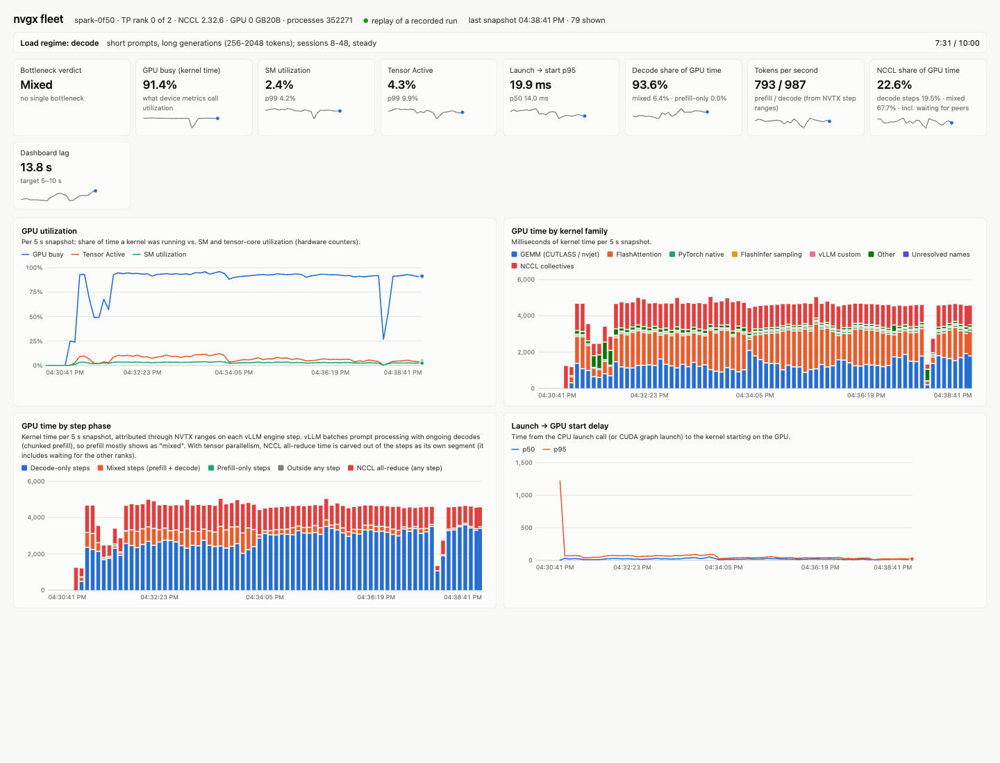

# 2026-11-22: vLLM tensor parallel across two DGX Sparks, NCCL in the profile

Stage 2 of [`plan/nccl-two-spark.md`](../../plan/nccl-two-spark.md), steps 1 and 2:

1. **What the Nsight Perf SDK already shows** about NCCL once vLLM runs with tensor parallelism 2 across the
   two Sparks, and the dashboard changes to show it.
2. **NCCL Inspector** (NCCL's own profiler plugin) on the traced side only: what it adds, and what it costs.

**Result:** both work, with NCCL 2.32.6 on both ranks. The SDK traces NCCL's all-reduce kernels with no plugin
at all: under this load, **25% of the traced GPU's kernel time is NCCL all-reduce** (18% inside decode steps,
57% inside mixed prefill + decode steps). Inspector adds what kernels can't: per-collective message size,
protocol, bandwidth and latency tails. It shows that **prefill-sized all-reduces (512 KB–2 MB) are 3.5% of
calls but 28% of all-reduce time**, running at ~2–4 GB/s on NCCL's LL128 protocol. Inspector had **no
measurable cost** on vLLM throughput or latency, but writes **~1.5 GB of JSON per 10 minutes**.

## Setup

| | |
|---|---|
| Nodes | 2× DGX Spark (GB10), direct QSFP RoCE link, one GPU each |
| Server | `vllm/vllm-openai:v0.33.0`, Qwen3-0.6B (bf16), `--tensor-parallel-size 2 --distributed-executor-backend mp --nnodes 2`, `--gpu-memory-utilization 0.10`, CUDA graphs on; [`poc/nccl/run_vllm_tp2.sh`](../../poc/nccl/run_vllm_tp2.sh) |
| Head (node rank 0) | Experiment DGX Spark: API server, traced by the Nsight Perf SDK, NVTX step ranges ([`poc/nvtx/`](../../poc/nvtx/README.md)), FleetSink → live dashboard |
| Worker (node rank 1) | The DGX Spark that serves other models: headless, not traced, 11.4 GB of GPU memory; its other services stayed healthy throughout |
| NCCL | **2.32.6+cuda13.5** on both ranks: unpacked `libnccl2` .deb, `LD_PRELOAD` (torch's process group) **and** `VLLM_NCCL_SO_PATH` (vLLM's own NCCL wrapper; log: `vLLM is using nccl==2.32.6`). `Using network IB`, both rails |
| Workload | [`nvgx_load.py`](../../poc/workload/README.md) `--scenario mixed --seed 2026 --duration 10m`: rag → chat → idle → decode → idle, ~2,380 requests, ~490k output tokens per run |
| Runs | Same seed three times: **baseline 1** (no plugin), **Inspector** on the head, **baseline 2** (no plugin) |

## Step 1: NCCL in the SDK's view (no plugin)

The SDK traces every kernel on the traced GPU, inside CUDA graphs too, so NCCL's all-reduce kernel
(`ncclDevKernel_AllReduce_bf16_RING`) shows up next to the GEMMs and FlashAttention: 23,000–37,000 launches
and ~1.1–1.4 s of GPU time per 5 s window under load, about as much as FlashAttention. Until now it was lumped into "Other".

FleetSink and the dashboard now break it out ([`poc/README.md`](../../poc/README.md#tensor-parallelism-nccl-time-2026-11-22)):
an `nccl` kernel family, the NCCL part of each step phase (`by_phase_nccl_ms`), an **NCCL share of GPU time**
tile, an NCCL segment in the step-phase chart, and the node's role in the header (`NVGX_FLEET_ROLE`).



*Replay of baseline 2 at 7:31 (decode regime), from the committed recording
[`2026-11-22-tp2-seed2026.json`](../../poc/fleet/static/recordings/2026-11-22-tp2-seed2026.json). Red = NCCL in both
charts. The step-phase chart shows how much of each step's GPU time is all-reduce.*

How to read it: an NCCL kernel runs until the other rank's data has arrived, so its time is **transfer plus
waiting for the peer**. On one side we can't separate the two (that needs both ranks traced with aligned
clocks); Inspector's latency tails below show how much is waiting.

## Step 2: NCCL Inspector on the traced side

Built from the v2.32.6-1 source inside the vLLM image (no host install) and loaded on the head only:
`NCCL_PROFILER_PLUGIN=libnccl-profiler-inspector.so NCCL_INSPECTOR_ENABLE=1`, dump every 1 s,
`NCCL_INSPECTOR_DUMP_MIN_SIZE_BYTES=0` (decode all-reduces are 2–48 KB, below the 8 KB default) and a 65,536-entry
ring (~5,000 all-reduces per second). NCCL logged `PROFILER/Plugin: Loaded Inspector (v8)`: the plugin built from
2.32.6 source exports profiler API v8 (its README still says v7 only).

Inspector writes one JSON record per collective: message size, algorithm/protocol, execution time measured on
the GPU (`kernel_gpu` for all 2.88 M records, CUDA graphs included), and bandwidth.

**10-minute run: 2,884,047 all-reduces (5,108/s), 115.8 s of execution time = 20.5% of wall time**

| Size band | Share of calls | Calls/s | Exec p50 | Exec p99 | Bus bandwidth p50 | Share of all-reduce time | Protocol |
|---|---|---|---|---|---|---|---|
| < 64 KB (decode) | 93% | 4,751 | 17 µs | 181 µs | 1.6 GB/s | 54% | LL |
| 64–512 KB | 1.8% | 94 | 119 µs | 737 µs | 2.7 GB/s | 8% | LL128 76%, LL 14% |
| **512 KB–2 MB (prefill)** | **3.5%** | 179 | 271 µs | 1,085 µs | 4.0 GB/s | **28%** | LL128 63%, SIMPLE 37% |
| ≥ 2 MB | 1.6% | 83 | 260 µs | 484 µs | 13.9 GB/s | 10% | SIMPLE |

Busiest message sizes:

| Size | Protocol | Calls | Exec p50 / p95 / p99 | Bus bandwidth p50 | > 5× p50 |
|---|---|---|---|---|---|
| 32 KB | LL | 1,359,733 | 18 / 26 / 188 µs | 1.82 GB/s | 2.1% |
| 16 KB | LL | 660,801 | 15 / 20 / 156 µs | 1.09 GB/s | 2.1% |
| 48 KB | LL | 261,002 | 22 / 31 / 245 µs | 2.23 GB/s | 2.1% |
| 4 MB | SIMPLE | 18,867 | 281 / 374 / 535 µs | 14.93 GB/s | 0.2% |
| 704 KB | LL128 | 3,420 | 342 / 841 / 1,149 µs | 2.11 GB/s | 0.2% |
| 864 KB | LL128 | 2,850 | 374 / 937 / 1,263 µs | 2.37 GB/s | 0.1% |

What it shows:

- **Decode all-reduces are fast but have a long tail.** 2–48 KB all-reduces take 9–22 µs at the median and
  130–250 µs at p99; ~2% take more than 5× the median. A 10× tail on a 2 KB message is waiting for the
  other Spark, not moving data.
- **Prefill-sized all-reduces are the expensive part.** 512 KB–2 MB messages, mostly on LL128 at ~2 GB/s,
  take a median 271 µs, more than a 4 MB message on SIMPLE (260–281 µs at ~15 GB/s). Stage 1's micro-benchmark
  showed the same thing (1 MB slower than 4 MB). NCCL's protocol choice on this link is a tuning lead.
- **The SDK and Inspector agree.** Inspector: all-reduce = 20.5% of wall time. SDK: NCCL = 25% of kernel time
  at 84% GPU busy ≈ 21% of wall time.

### Overhead: three runs, same seed

| Run | Requests | Errors | Output tok/s | TPOT p50 chat / decode / rag | TTFT p50 chat / decode / rag | NCCL share of kernel time | NCCL in decode / mixed steps |
|---|---|---|---|---|---|---|---|
| Baseline 1 (no plugin) | 2,373 | 0 | 813 | 12.3 / 9.5 / 16.4 ms | 68 / 53 / 102 ms | –* | –* |
| **Inspector** (head only) | 2,386 | 0 | **821** | 12.1 / 9.5 / 16.2 ms | 66 / 54 / 99 ms | 24.9% | 18.1% / 56.5% |
| Baseline 2 (no plugin) | 2,375 | 0 | **820** | 12.4 / 9.6 / 16.2 ms | 70 / 54 / 100 ms | 25.0% | 17.8% / 57.3% |

\* Half of baseline 1 ran on the exporter build without the `nccl` family (NCCL counted as "Other").

**Inspector's cost is below the noise**: throughput, TPOT and TTFT per regime match the baselines, and so does
the NCCL share the SDK measures. Its real cost is **output volume**: 1.5 GB of JSON in 10 minutes (~520 bytes
per collective). For always-on use that calls for Inspector's aggregated OTLP / Prometheus modes, or our own
plugin that aggregates per window ([plan, stage 3](../../plan/nccl-two-spark.md#stages)).

## Problems found

- **The exporter can't keep up under TP=2 load.** Dashboard lag rose to 13–16 s (target 5–10 s), and
  baseline 2 produced 100 profiles in 650 s instead of ~130: snapshots took longer than their 5 s window.
  The traced rank launched 31,000–78,000 kernels per second in this run, ~5,000 of them all-reduces.
  The DuckDB copy is the known slow path ([POC README](../../poc/README.md)); running
  FleetSink without it is the next thing to try.
- **The verdict doesn't know about communication.** With a quarter of kernel time in NCCL it says
  "mixed" or "host-bound". A "communication-bound" verdict (NCCL share above a threshold) is an easy addition.
- **One-sided view.** As planned, only the head is traced; which rank was late stays unknown.

## Next

1. **Protocol experiment:** rerun the seeded workload with `NCCL_PROTO=^LL128` (or a tuner plugin that only
   changes 512 KB–2 MB), and compare prefill-heavy (rag) TTFT and the 512 KB–2 MB band.
2. **Exporter throughput:** FleetSink-only export (no DuckDB) under TP=2 load; lag back under 10 s.
3. **Aggregated NCCL data:** Inspector's OTLP mode, or a small plugin, feeding a per-window NCCL section into
   FleetSink's profile (count, bytes, latency histogram per size band).

## Reproduce

Both Sparks, after stage 1's `~/nccl-lab` setup ([plan, Reproduce](../../plan/nccl-two-spark.md#reproduce)); the
head also needs the Nsight Perf root service, the NVTX hook and the forked exporter ([`poc/README.md`](../../poc/README.md)).

```shell
# NCCL Inspector, built once inside the image (head only)
docker run --rm -v ~/nccl-lab:/lab -w /lab/nccl-src/plugins/profiler/inspector --entrypoint bash \
  vllm/vllm-openai:v0.33.0 -c "make -j8 && cp libnccl-profiler-inspector.so /lab/"

# worker (the other Spark), then head; <head-link-ip> = head's address on the direct link
poc/nccl/run_vllm_tp2.sh worker <head-link-ip>
INSPECTOR=1 poc/nccl/run_vllm_tp2.sh head <head-link-ip>       # leave out INSPECTOR=1 for the baselines

# exporter role label, then the seeded workload against the head
NVGX_FLEET_ROLE="TP rank 0 of 2 · NCCL 2.32.6" OUT=... poc/nvtx/exporter-supervisor.sh
python3 poc/workload/nvgx_load.py --scenario mixed --seed 2026 --duration 10m --model qwen3-0.6b-tp2

# analysis
python3 poc/nccl/inspector_summary.py ~/nccl-lab/inspector/<host>-pid<pid>.log --start <t0> --end <t1>
python3 poc/nccl/compare_runs.py --run baseline=a.jsonl --run inspector=b.jsonl --fleet-db ~/.nvgx-fleet/fleet.db
```
