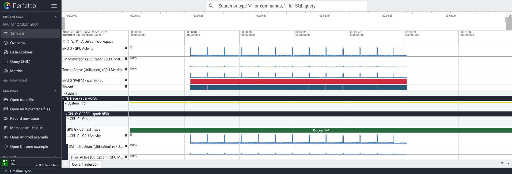
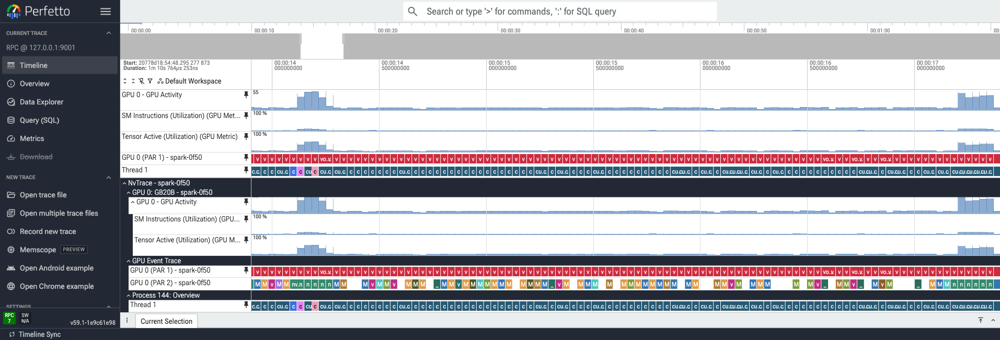
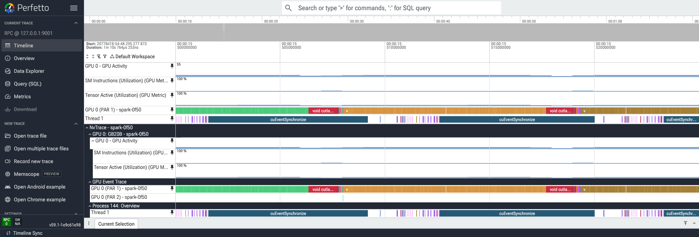
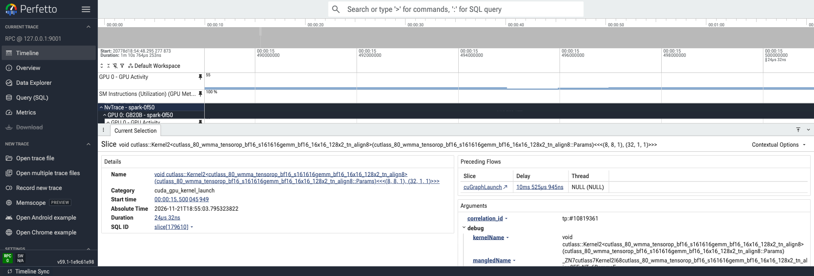
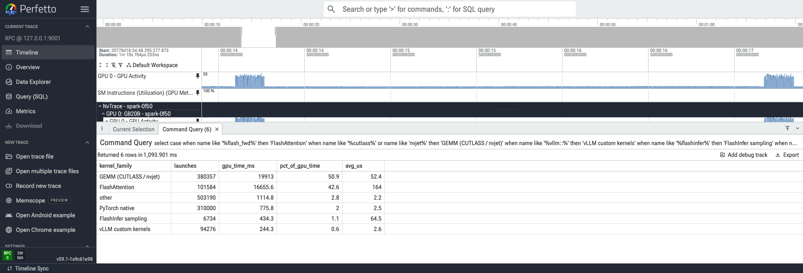

# Showcase: vLLM serving Qwen3-0.6B on DGX Spark (2026-11-21)

What the NVIDIA Nsight Perf SDK for AI captures from a real LLM-serving workload, viewed in
[Perfetto](https://ui.perfetto.dev). All five views come from one 70-second capture taken while a
benchmark was running. Tracing overhead in this run was within noise (< 0.5%).

## Setup

| | |
|---|---|
| Hardware | DGX Spark (GB10), stock R580 kernel driver, CUDA 13.5 compat user-mode driver for the workload ([Option A](../../plan/option-a-cuda-compat.md)) |
| Workload | `vllm/vllm-openai:v0.33.0`, `Qwen/Qwen3-0.6B` (bf16), CUDA graphs on, `--gpu-memory-utilization 0.25` |
| Load | `vllm bench serve`: 200 random prompts, 512 tokens in / 256 out, concurrency 16 (~1295 output tok/s, 11.6 ms per output token) |
| Capture | `nvtrace_streaming_consumer`, 70 s; exported with `nvtrace_perfetto_trace_exporter` (67 MB zip) |
| Viewer | ui.perfetto.dev with `trace_processor` running on the Spark as the native accelerator (`scripts/view-trace.sh`) |
| Run report | [`results/2026-11-21-option-a-dgx-spark.md`](../../results/2026-11-21-option-a-dgx-spark.md) |

Track names in the screenshots include the Spark's host name; below it's written as `<hostname>`.

## 1. GPU utilization over the whole run



**What's on screen:** the full 70 s, with five tracks pinned on top:

- **GPU 0 – GPU Activity**: summary utilization track.
- **SM Instructions (Utilization)** and **Tensor Active (Utilization)**: GPU performance counters, sampled at ~1 kHz.
- **GPU 0 (PAR 1) – `<hostname>`**: every GPU kernel (solid at this zoom).
- **Thread 1**: the CUDA driver API calls of the vLLM engine process.

**How to read it:** the benchmark runs from ~0:11 to ~0:50. GPU Activity shows **12 regular spikes, one
every 3.08 s** (first at 11.01 s, then 14.10 s, 17.17 s, ...). 200 prompts at concurrency 16 make ~12.5
"waves" of requests. Each spike is the **prefill** of a new wave: 16 × 512 prompt tokens processed at once.
Between spikes the GPU is **decoding** 256 tokens per request, one token at a time.

**Numbers (benchmark window 11.0–50.5 s):**

| Counter | Average | Peak |
|---|---|---|
| Tensor Active (Utilization) | 8.6% | 54.6% (prefill) |
| SM Instructions (Utilization) | 3.7% | 13.3% |
| GPU Activity (summary) | 8.8 | 54.6 |

## 2. One wave: prefill burst, then decode



**What's on screen:** 13.9–17.4 s, one complete wave.

**How to read it:** at ~14.1 s the **prefill burst** lights up GPU Activity and Tensor Active (large
matrix multiplies on tensor cores). Then ~3 s of **decode**: utilization drops to a low, steady level
until the next wave's prefill at 17.2 s. At this zoom the kernel track (`v…` boxes), the CUDA API
thread (`cu…` calls) and the copy-engine track (**GPU 0 (PAR 2)**, `M` = memcpy) already show individual
groups of work.

## 3. Inside decode: CPU launches, GPU executes



**What's on screen:** 25 ms in the middle of decoding (15.500–15.525 s).

**How to read it:** you can see the rhythm of **decode steps, ~11.5 ms each**. That matches the
measured 11.6 ms per output token.

- **CPU (Thread 1):** a burst of short launch calls, then a long **`cuEventSynchronize`**: the engine
  waits for the GPU to finish the step before scheduling the next token.
- **GPU (PAR 1):** dense bands of very small kernels plus a **`void cutlass…`** GEMM in every step.
- vLLM runs each decode step as a **CUDA graph**. The trace has **3,326 `cuGraphLaunch` calls**, which
  matches the expected number of decode steps (200 prompts × 256 tokens ÷ 16 concurrent ≈ 3,200).

## 4. One kernel: details and the launch that queued it



**What's on screen:** one CUTLASS bf16 GEMM kernel selected (15.500046 s, 24 µs), with Perfetto's
details panel.

**How to read it:**

- **Details:** full demangled kernel name with grid/block size `<<<(8, 8, 1), (32, 1, 1)>>>`, category
  `cuda_gpu_kernel_launch`, start time and duration.
- **Preceding Flows:** the kernel is linked to the **`cuGraphLaunch`** call that launched it, **10.5 ms
  earlier**. The CPU enqueues the whole decode step as a graph, and the GPU reaches this kernel later in
  the step. The capture contains 1.41 M such API→GPU links.
- **Arguments:** correlation IDs, demangled and mangled names, stream, and CUDA-graph fields
  (`isGraphLaunch`, `graphExecId`), so kernels inside graphs are attributed to their launch.

## 5. Where the GPU time goes (SQL in Perfetto)



**What's on screen:** a SQL query run inside Perfetto over all 1.4 M kernels in the capture.

| Kernel family | Launches | GPU time | Share | Average |
|---|---|---|---|---|
| GEMM (CUTLASS / nvjet) | 380,357 | 19.9 s | 50.9% | 52 µs |
| FlashAttention | 101,584 | 16.7 s | 42.6% | 164 µs |
| Other | 503,190 | 1.1 s | 2.8% | 2 µs |
| PyTorch native | 310,000 | 0.8 s | 2.0% | 2.5 µs |
| FlashInfer sampling | 6,734 | 0.4 s | 1.1% | 65 µs |
| vLLM custom kernels | 94,276 | 0.2 s | 0.6% | 2.6 µs |

**How to read it:** matrix multiplies and attention take **93%** of GPU time. Kernel time adds up to
**39.1 s within the 39.5 s benchmark window**, so a kernel was running ~99% of the time, while SM
utilization averaged only 3.7%. In other words, the GPU is always busy but mostly with small, short
kernels: a 0.6B model doesn't come close to filling a GB10. (Our reading; a larger model is the next
showcase to check it.)

## Reproduce these views

1. Capture and export a trace ([quick start](../../README.md#quick-start-dgx-spark)), then open it with
   `scripts/view-trace.sh <ssh-host> '<trace.zip on the Spark>'`.
2. Pin tracks (pin icon next to the name): **GPU 0 – GPU Activity**, **SM Instructions (Utilization)**,
   **Tensor Active (Utilization)**, **GPU 0 (PAR 1) – `<hostname>`**, **Thread 1**.
3. Zoom with W/S, pan with A/D. Windows used above: whole trace; 13.9–17.4 s; 15.500–15.525 s;
   15.489–15.501 s.
4. Click a kernel to see its details and flows.
5. SQL for view 5 (Perfetto: **Query (SQL)** page, or type `:` in the search bar):

```sql
select
  case
    when name like '%flash_fwd%' then 'FlashAttention'
    when name like '%cutlass%' or name like 'nvjet%' then 'GEMM (CUTLASS / nvjet)'
    when name like '%vllm::%' then 'vLLM custom kernels'
    when name like '%flashinfer%' then 'FlashInfer sampling'
    when name like '%at::native%' then 'PyTorch native'
    else 'other'
  end as kernel_family,
  count(*) as launches,
  round(sum(dur) / 1e6, 1) as gpu_time_ms,
  round(100.0 * sum(dur) / (select sum(dur) from slice where category = 'cuda_gpu_kernel_launch'), 1) as pct_of_gpu_time,
  round(avg(dur) / 1e3, 1) as avg_us
from slice
where category = 'cuda_gpu_kernel_launch'
group by 1
order by gpu_time_ms desc;
```

The trace file itself isn't in the repo (size, and it embeds the host name).
