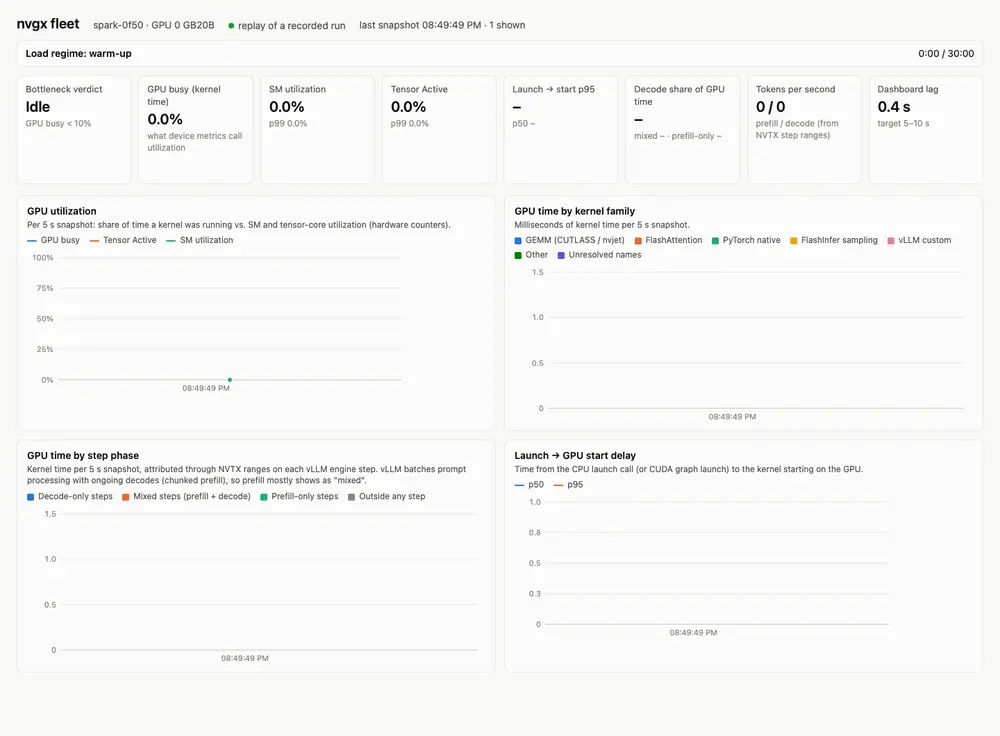
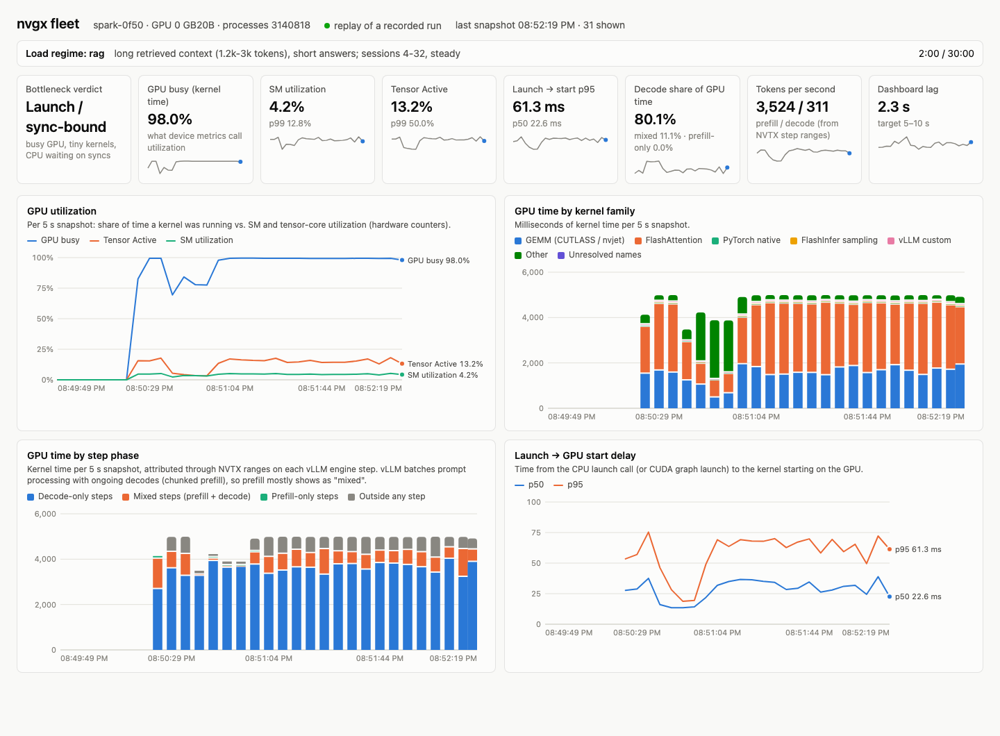
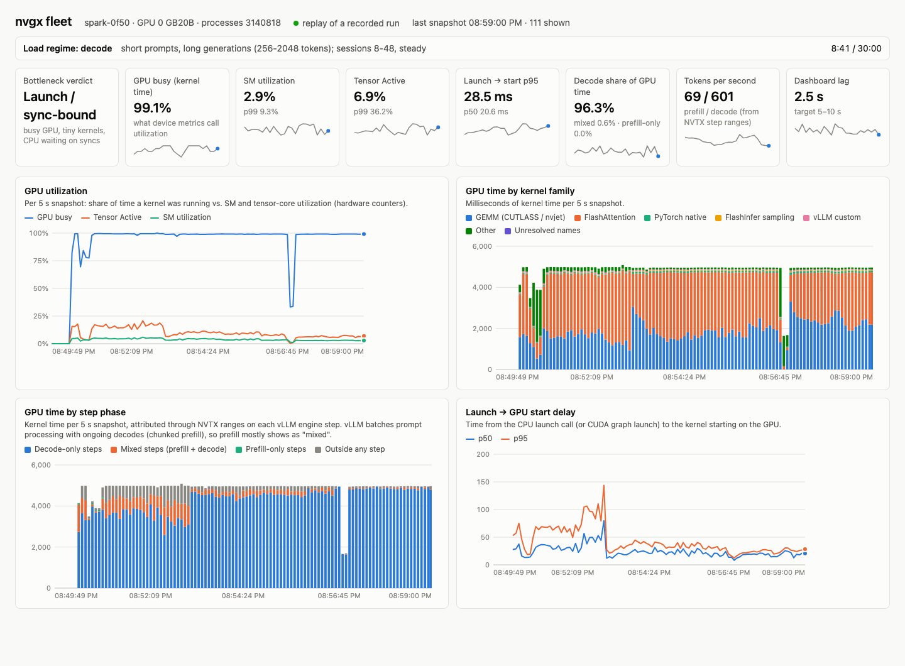
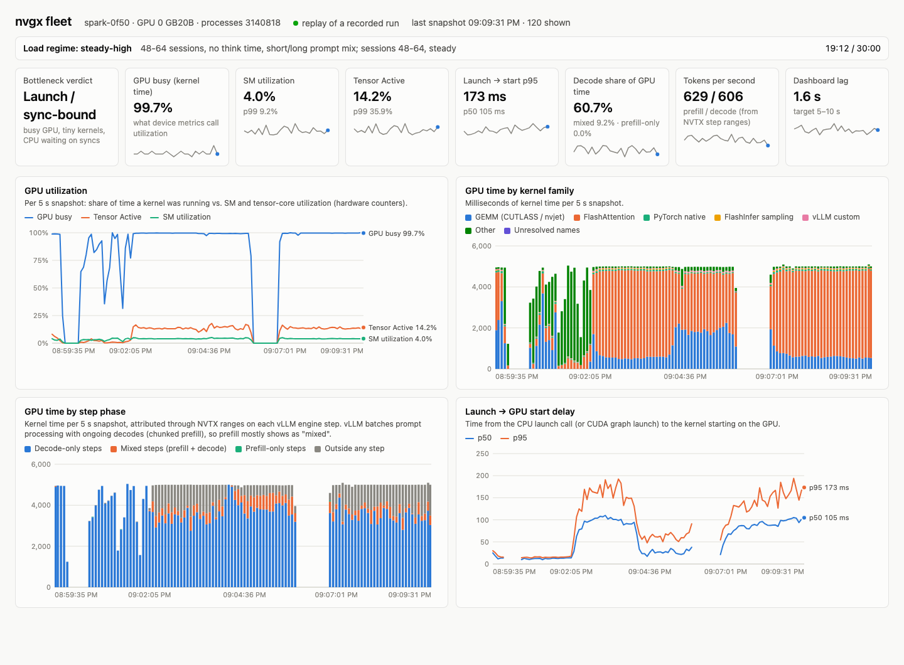
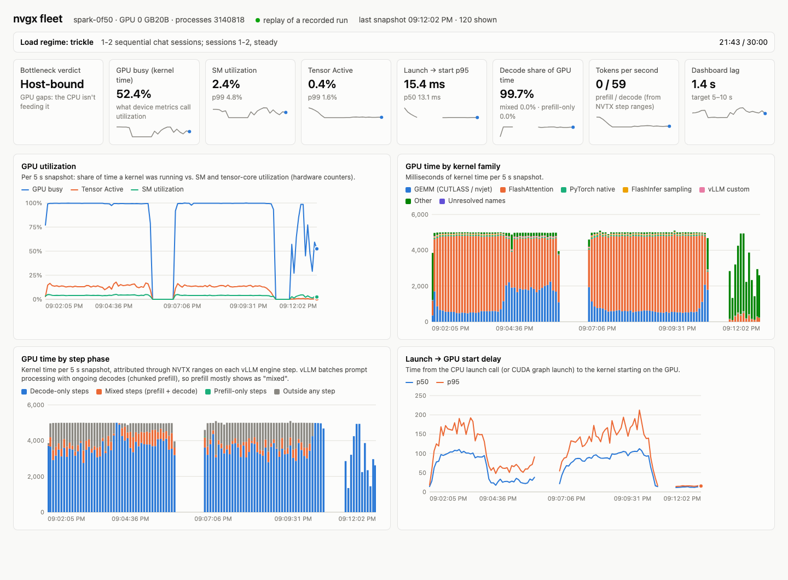

# Showcase: live fleet dashboard under a variable workload (2026-11-22)

A 30-minute run of the [live fleet dashboard](../../poc/README.md) on a DGX Spark, as an 18.6 s time-lapse:
a seeded variable workload drives vLLM through different load regimes, and the dashboard follows each one,
built from 5 s workload profiles streamed by the Nsight Perf SDK for AI.

*186 frames, one per 10 s of the run (every second 5 s snapshot), each showing the previous 10 minutes. The
banner names the load regime that was active and the elapsed time.*

## Setup

| | |
|---|---|
| Hardware | DGX Spark (GB10), stock R580 kernel driver, CUDA 13.5 compat driver for the workload ([Option A](../../plan/option-a-cuda-compat.md)) |
| Server | vLLM 0.33.0, Qwen3-0.6B (bf16), CUDA graphs on, `--gpu-memory-utilization 0.25`, NVTX step ranges on ([`poc/nvtx/`](../../poc/nvtx/README.md)) |
| Workload | [`nvgx_load.py`](../../poc/workload/README.md) `--scenario mixed --seed 2026 --duration 30m`: 18 regimes, **5,078 requests, 0 errors**, 1.0 M output tokens |
| Pipeline | Forked `nvtrace_continuous_export` with FleetSink, 5 s snapshots → fleet service + dashboard on a laptop ([`poc/`](../../poc/README.md)); **0 exporter restarts** in the run |
| Time-lapse | Rendered from the recorded profiles in [`poc/fleet/static/recordings/`](../../poc/fleet/static/recordings/) with [`tools/timelapse/`](../../tools/timelapse/README.md) (dashboard replay mode + headless Chrome → animated WebP, 4.9 MB) |

The seeded schedule ran: rag → chat → idle → decode → idle → trickle → steady-high → rag → idle → steady-high →
idle → trickle → rag → idle → chat → trickle → idle → chat. (This seed had no `burst` regime in its first 30 minutes.)

## What changes from regime to regime

Per regime type, combining the load generator's own measurements (left) with the dashboard's profiles for the
same periods (right; the first 5 s of each regime are skipped because requests still in flight spill over):

| Regime | What it sends | Output tok/s | TTFT p50 / p95 | TPOT p50 | GPU busy | SM | Tensor | Decode / mixed / outside a step | Launch → start p95 | Verdict |
|---|---|---|---|---|---|---|---|---|---|---|
| **rag** | 1.2k–3k-token prompts, short answers | 333 | 0.095 / 0.183 s | 21.8 ms | 96% | 4.3% | 12.8% | 79 / 11 / 10% | 60 ms | launch / sync-bound |
| **chat** | multi-turn, 2–40 sessions | 855 | 0.064 / 0.092 s | 18.6 ms | 99% | 3.9% | 9.3% | 92 / 4 / 4% | 35 ms | launch / sync-bound |
| **decode** | short prompts, 256–2,048-token answers | 934 | 0.046 / 0.064 s | 13.4 ms | 99% | 3.2% | 6.8% | 97 / 1 / 2% | 26 ms | launch / sync-bound |
| **steady-high** | 48–64 sessions, no think time | 982 | 0.203 / 0.304 s | 57.4 ms | 100% | 4.1% | 13.7% | 69 / 7 / 24% | 149 ms | launch / sync-bound |
| **trickle** | 1–2 sequential sessions | 100 | 0.027 / 0.045 s | 8.3 ms | 71% | 3.0% | 1.1% | 99 / 0 / 0% | 15 ms | host-bound |
| **idle** | nothing | 0 | – | – | 23%* | 0.8% | 1.2% | – | – | idle |

\* In-flight requests from the previous regime keep the GPU busy for a while after an idle gap starts; the
banner switches when the generator stops sending, not when the GPU goes quiet.

**How to read it:**

- **"GPU busy" never tells the story.** It's 96–100% in every loaded regime, yet SM utilization stays at
  3–4%: a 0.6B model keeps the GB10 busy with small kernels and synchronization, not with work. The
  verdict (launch / sync-bound) and the regime-specific numbers are what change.
- **Prefill-heavy (rag)** shows up as tensor-core activity (12.8%), more mixed steps (11%), FlashAttention's
  share of GPU time rising, and 2–3× the launch delay of decode-heavy work.
- **Saturation (steady-high)** shows as time per output token jumping to 57 ms (from 13–22 ms) and launch →
  start delay p95 to ~150 ms: requests queue on the GPU. Time to first token doubles.
- **Light load (trickle)** flips the verdict to **host-bound**: the GPU waits for the CPU (busy 71%).

## Key frames

### Prefill-heavy: rag (≈ 2:00)

Long prompts: FlashAttention (orange) dominates the kernel-family chart, Tensor Active rises, and mixed steps
(orange in the phase chart) appear whenever new prompts are batched with ongoing decodes.

### Decode-heavy: decode (≈ 8:40)

Long generations: almost all GPU time is in decode-only steps (blue), launch delay is low (~26 ms p95), and
time per token is the best of any loaded regime (13 ms).

### Saturated: steady-high (≈ 19:10)

48–64 sessions with no think time: launch → start delay climbs to 100–200 ms, and a gray band appears in the
phase chart: GPU time **outside any NVTX step range** (see the open question below).

### Light: trickle (≈ 21:40)

One or two sequential sessions: GPU busy drops below 100%, the verdict turns host-bound, and the kernel mix
shifts to small kernels ("Other").

## Open question: GPU time outside any step grows with load

The share of kernel time that FleetSink can't attribute to a vLLM step (gray, "outside any step") is 0% in
trickle, 2% in decode, 4% in chat, 10% in rag and 24% in steady-high. The exporter reported no lost data
(no history-bank warnings) in this run, so it isn't dropped trace data. Candidates to check next:

- **CPU/GPU overlap in vLLM:** with async scheduling, work for the next step may be launched outside the hook's
  range (which runs from `execute_model` to that step's `sample_tokens`).
- **Snapshot boundaries:** CUDA graphs launched just before a 5 s window can run inside it, and FleetSink
  splits a graph's kernel time by its launches *within* the window.

An exact per-kernel Perfetto capture under `steady-high` (as done for the [NVTX verification](../../poc/nvtx/README.md))
would separate the two.

## Timing

- Lag from the end of a snapshot window to the profile on the dashboard: p50 2.3 s, p95 3.3 s, max 4.1 s, so
  the newest data was at most ~9 s old.
- Exporter time per 5 s snapshot (DuckDB + FleetSink): 1.6 s on average, 4.1 s at peak under steady-high —
  close to the 5 s budget (see the DuckDB note in the [POC README](../../poc/README.md)).

## Reproduce

1. Run the POC ([`poc/README.md`](../../poc/README.md)) with NVTX (`NVTX=1 scripts/run-vllm.sh`) and start
   `poc/workload/nvgx_load.py --scenario mixed --seed 2026 --duration 30m`, keeping its console log.
2. Export and render as in [`tools/timelapse/README.md`](../../tools/timelapse/README.md):
   `--step 2 --fps 10 --size 1440,1060 --window 120 --keyframes 30,110,236,266`.

The recording used here is committed, so step 2 alone re-renders this time-lapse.
