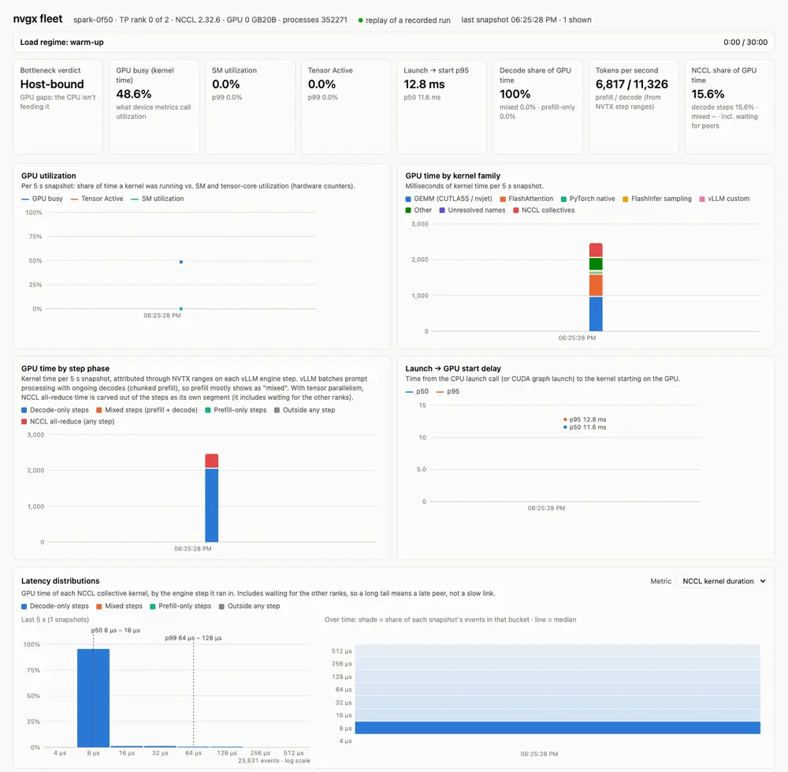
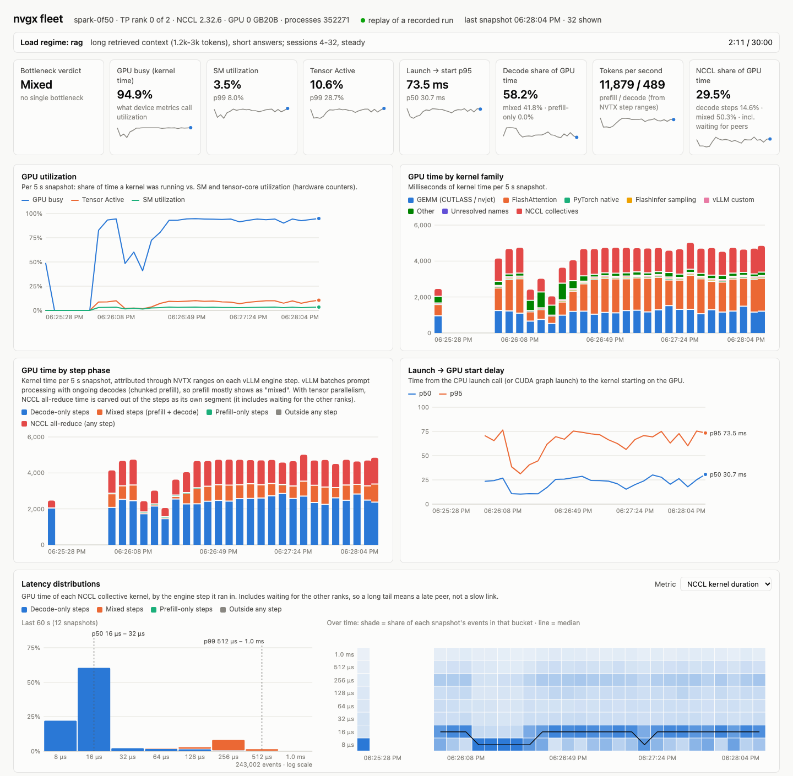
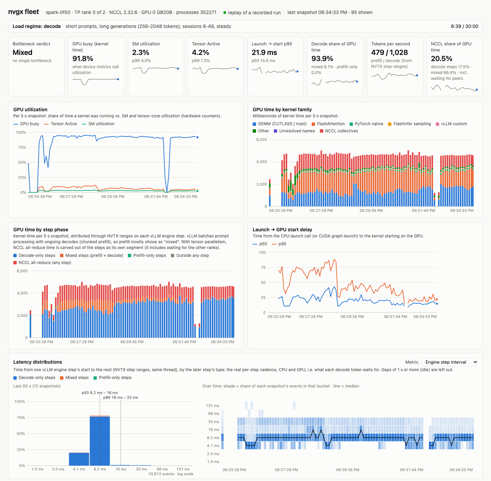
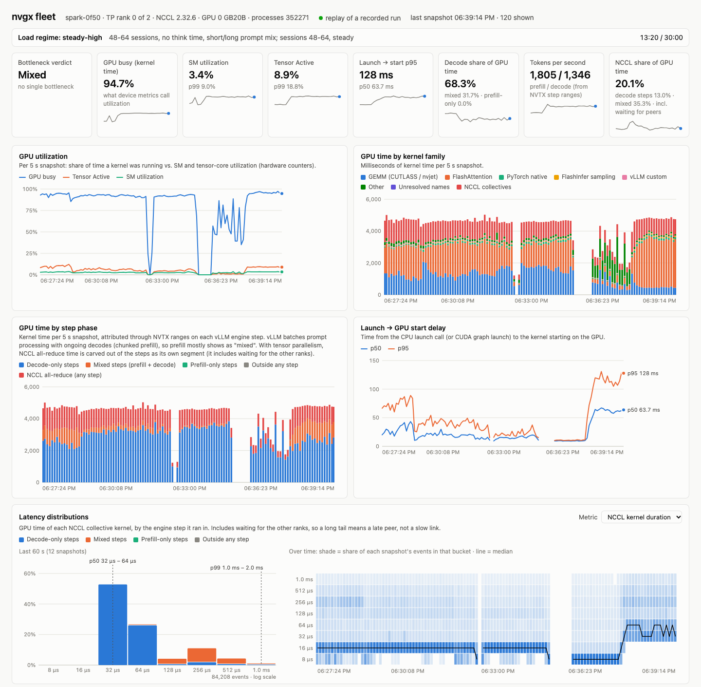
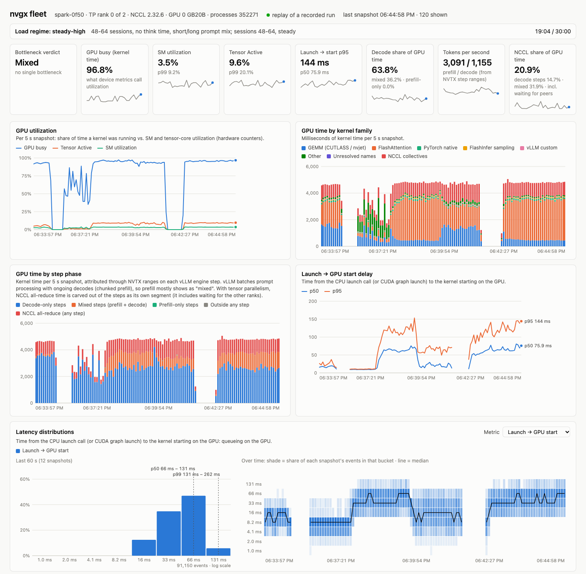
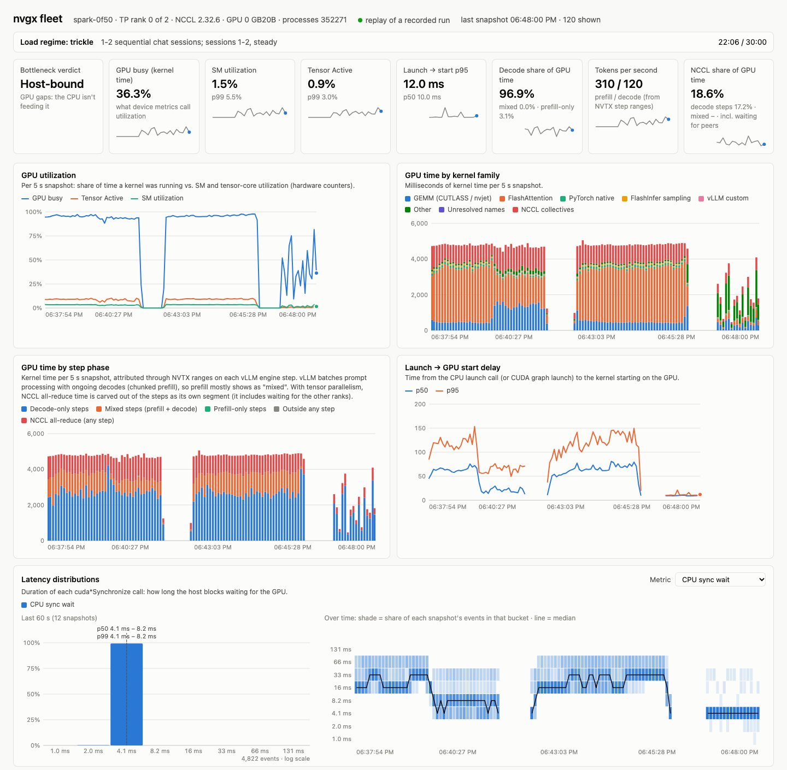

# Showcase: tensor parallelism across two DGX Sparks, with latency distributions (2026-11-22)

vLLM split across two DGX Sparks (tensor parallelism 2, NCCL 2.32.6 over the direct RoCE link), driven by the
same seeded 30-minute workload as the [single-Spark showcase](../2026-11-22-live-fleet-dashboard/README.md),
shown as an animated time-lapse of the [live fleet dashboard](../../poc/README.md). New in this run: NCCL
all-reduce time as its own kernel family and step-phase segment, and the **latency distributions** card
(histogram + heatmap per metric).

*One frame per 10 s of the run, each showing the previous 10 minutes. The bottom card shows NCCL kernel duration
throughout: the last 60 s as a histogram (p50/p99 marked), and every snapshot as a column of the heatmap
(shade = share of that snapshot's all-reduces in each latency bucket, line = median).*

## Setup

| | |
|---|---|
| Hardware | 2× DGX Spark (GB10), direct QSFP cable, RoCE on both rails; stock R580 kernel driver, CUDA 13.5 compat driver for the workload ([Option A](../../plan/option-a-cuda-compat.md)) |
| Server | vLLM 0.33.0, Qwen3-0.6B (bf16), `--tensor-parallel-size 2 --nnodes 2`, `--gpu-memory-utilization 0.10` per rank, CUDA graphs on, NVTX step ranges ([`poc/nccl/run_vllm_tp2.sh`](../../poc/nccl/run_vllm_tp2.sh)) |
| NCCL | 2.32.6 on both ranks, loaded into the unchanged vLLM image ([plan](../../plan/nccl-two-spark.md)); no NCCL plugin in this run |
| Traced | Node rank 0 only (API server + TP rank 0), by the Nsight Perf SDK for AI; the other Spark runs rank 1 headless |
| Workload | [`nvgx_load.py`](../../poc/workload/README.md) `--scenario mixed --seed 2026 --duration 30m`: the same 18-regime schedule as the single-Spark showcase. **6,142 requests, 0 errors**, 1.25 M output tokens |
| Pipeline | Forked `nvtrace_continuous_export` with FleetSink (NCCL family, latency histograms), 5 s snapshots → fleet service + dashboard on a laptop; 0 exporter restarts |
| Time-lapse | Recording [`2026-11-22-tp2-mixed-seed2026.json`](../../poc/fleet/static/recordings/2026-11-22-tp2-mixed-seed2026.json), rendered with [`tools/timelapse/`](../../tools/timelapse/README.md) (`--query hist=nccl`) |

Schedule: rag → chat → idle → decode → idle → trickle → steady-high → rag → idle → steady-high → idle → trickle →
rag → idle → chat → trickle → idle → chat.

## Regime by regime

From the load generator (left) and the traced rank's profiles (right; first 5 s of each regime skipped),
via [`regime_stats.py`](../../tools/timelapse/regime_stats.py):

| Regime | Output tok/s | TTFT p50 / p95 | TPOT p50 | GPU busy | Decode / mixed | NCCL share of kernel time | Launch → start p95 |
|---|---|---|---|---|---|---|---|
| **rag** | 388 | 0.096 / 0.164 s | 14.5 ms | 88% | 70 / 29% | 27% | 65 ms |
| **chat** | 1,044 | 0.071 / 0.104 s | 13.2 ms | 92% | 84 / 16% | 24% | 41 ms |
| **decode** | 1,189 | 0.055 / 0.086 s | 9.5 ms | 92% | 94 / 6% | 22% | 22 ms |
| **steady-high** | 1,313 | 0.164 / 0.253 s | 41.9 ms | 96% | 64 / 36% | 22% | 119 ms |
| **trickle** | 122 | 0.051 / 0.072 s | 5.7 ms | 52% | 98 / 0% | 19% | 11 ms |

Over the whole run NCCL all-reduce is **23.5% of the traced GPU's kernel time**.

### Latency distributions per regime

p50 / p99 as log2 buckets, from the histograms summed over each regime's profiles:

| Regime | NCCL kernel duration | Engine step interval | Launch → GPU start | CPU sync wait |
|---|---|---|---|---|
| rag | 16–32 µs / 0.5–1 ms | 8–16 ms / 33–66 ms | 16–33 ms / 66–131 ms | 8–16 ms / 33–66 ms |
| chat | 16–32 µs / 0.5–1 ms | 8–16 ms / 33–66 ms | 16–33 ms / 33–66 ms | 8–16 ms / 33–66 ms |
| decode | 16–32 µs / 256–512 µs | 8–16 ms / 16–33 ms | 8–16 ms / 33–66 ms | 8–16 ms / 16–33 ms |
| **steady-high** | **64–128 µs / 1–2 ms** | **33–66 ms / 66–131 ms** | **33–66 ms / 131–262 ms** | 33–66 ms / 66–131 ms |
| trickle | 8–16 µs / 128–256 µs | 4–8 ms / 4–8 ms | 8–16 ms / 16–33 ms | 4–8 ms / 4–8 ms |

**How to read it:**

- **The step interval is the token clock.** Its median matches TPOT in every regime (decode 8–16 ms vs TPOT
  9.5 ms; steady-high 33–66 ms vs 41.9 ms; trickle 4–8 ms vs 5.7 ms). The histogram also shows the spread:
  in decode almost every step lands in one bucket, while rag and chat have a tail to 33–66 ms from steps that
  batch in a prompt.
- **All-reduces are cheap until the batch grows.** Decode-sized all-reduces take 16–32 µs (8–16 µs when the
  GPU is lightly loaded in trickle). Under steady-high, with 48–64 sessions batched, the median moves to
  64–128 µs and p99 to 1–2 ms. Bigger batches mean bigger all-reduce messages, into the 64 KB–2 MB range that
  [NCCL Inspector measured](../../results/2026-11-22-nccl-tp2/README.md#step-2-nccl-inspector-on-the-traced-side)
  at only 2–4 GB/s (an inference from the two measurements; this run had no Inspector).
- **Queueing shows as a wide launch delay.** Launch → GPU start has a median of 33–66 ms and a p99 of
  131–262 ms under steady-high: kernels wait several steps on the GPU, the same saturation the single-Spark
  showcase saw (p95 ~150 ms there, 119 ms here).
- **The heatmap shows when it changes.** In the time-lapse, the NCCL median line steps up each time steady-high
  starts and drops back in trickle; the second band at 128–512 µs (prefill all-reduces) thickens in rag.

### Compared with one DGX Spark (same seed)

| Regime | Output tok/s: 1 Spark → 2 Sparks | TPOT p50: 1 Spark → 2 Sparks |
|---|---|---|
| rag | 333 → 388 | 21.8 → 14.5 ms |
| chat | 855 → 1,044 | 18.6 → 13.2 ms |
| decode | 934 → 1,189 | 13.4 → 9.5 ms |
| steady-high | 982 → 1,313 | 57.4 → 41.9 ms |
| trickle | 100 → 122 | 8.3 → 5.7 ms |

Tensor parallel 2 was faster in every regime, by 16–34% in throughput and 27–33% in time per token, even
though a quarter of the GPU time goes to all-reduce. For a 0.6B model the single GPU is launch/sync-bound
(SM utilization ~4%), so halving each rank's GEMM and attention work while adding ~20 µs all-reduces is a net
win. The two runs differ in more than tensor parallelism, though: different days and exporter builds, and
`--gpu-memory-utilization` 0.25 there vs 0.10 per rank here. Treat this as an observation, not a benchmark.

## Key frames

### Prefill-heavy: rag, NCCL kernel duration (≈ 2:10)

Two humps: decode all-reduces at 16–32 µs, and prefill all-reduces (mixed steps, orange) at 128–512 µs.
NCCL (red) is a large slice of every step in the phase chart.

### Decode-heavy: decode, engine step interval (≈ 8:40)

Steps arrive every 8–16 ms, nearly all in one bucket: a steady 9.5 ms per token.

### Saturated: steady-high, NCCL kernel duration (≈ 13:20)

The NCCL median line in the heatmap steps up from 8–32 µs (trickle, then rag) to 32–128 µs the moment 48–64
sessions are batched, and the p99 reaches 1–2 ms.

### Saturated: steady-high, launch → GPU start (≈ 19:05)

Kernels queue: in this minute launch delay has a median of 66–131 ms and a p99 of 131–262 ms; the heatmap shows
it stepping up from 8–16 ms each time a steady-high period starts.

### Light: trickle, CPU sync wait (≈ 22:05)

One or two sessions: GPU busy drops to ~50%, the verdict turns host-bound, and every sync wait lands in 4–8 ms.
The heatmap shows the contrast with the steady-high periods before it (median 16–33 ms).

## Timing and data quality

- **The exporter struggles under this load.** It took 3.7 s per snapshot on average (p95 7.2 s, max 8.7 s)
  and **146 of ~314 snapshots took longer than their 5 s window**; for those the SDK warns that trace data may
  be lost. Snapshot windows stretched to p95 8.6 s, and the run produced 314 profiles instead of ~360. Shares,
  ratios and distributions are what the dashboard shows, so they stay meaningful as long as the loss is spread
  evenly, but absolute counts per snapshot are low. The local DuckDB copy is the known slow path ([POC README](../../poc/README.md));
  FleetSink without it is the next step.
- Lag from the end of a snapshot window to the dashboard: p50 4.8 s, p95 11.4 s, max 14.6 s.

## Reproduce

1. Two DGX Sparks set up as in [`plan/nccl-two-spark.md`](../../plan/nccl-two-spark.md#reproduce); start
   [`run_vllm_tp2.sh`](../../poc/nccl/run_vllm_tp2.sh) `worker` and `head`, the forked exporter with
   `NVGX_FLEET_ROLE`, and the fleet service ([`poc/README.md`](../../poc/README.md)).
2. `python3 poc/workload/nvgx_load.py --scenario mixed --seed 2026 --duration 30m --model qwen3-0.6b-tp2`, keeping its
   console log and JSONL.
3. Export and render as in [`tools/timelapse/README.md`](../../tools/timelapse/README.md):
   `--step 2 --fps 10 --size 1440,1410 --window 120 --query hist=nccl --keyframes 31:nccl,94:interval,142:nccl,209:launch,245:sync`.
4. Tables: `python3 tools/timelapse/regime_stats.py --recording <recording> --load-log <run>.jsonl`.

The recording is committed, so steps 3–4 alone re-render this showcase.
